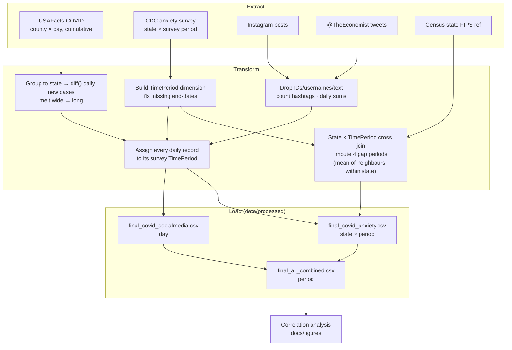
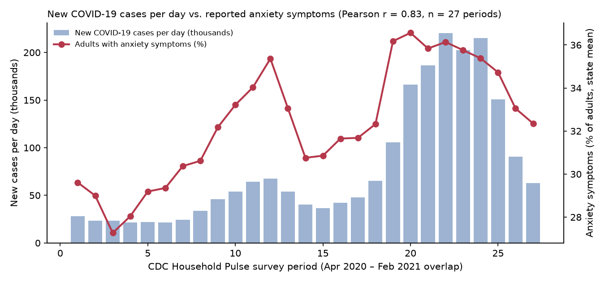

# COVID-19 × Anxiety × Social Media: Multi-Source ETL Pipeline

**A Python/pandas pipeline that integrates four public datasets with incompatible grains, keys and date formats into analysis-ready tables, then explores how pandemic case counts tracked reported anxiety and social media engagement.**


> **Origin:** a four-person graduate project in **Business Intelligence** at Texas Tech University (2021). Refactored in 2026 to run on current pandas. The refactored outputs were checked against the 2021 deliverable and matched it exactly; one bug found afterwards has since been fixed (see the [changelog](CHANGELOG.md)).

---

## TL;DR

- **Pipeline:** integrates four public datasets (COVID-19 cases, a CDC anxiety survey, Instagram posts and @TheEconomist tweets) plus a Census state reference, each with a different grain, key and date format, into three analysis-ready tables.
- **Finding:** new COVID-19 cases and the share of adults reporting anxiety symptoms moved together across 27 survey periods (**Pearson r = 0.80**; 0.83 per day, 0.54 on changes between periods). This is a correlation, not evidence of causation.
- **Privacy:** user IDs, usernames and post text are dropped before aggregation; only aggregated tables with no PII are published.
- **Reproducibility:** the 2026 refactor reproduced the 2021 deliverable's outputs exactly; the raw files are identified by SHA-256 in [`data/README.md`](data/README.md).

---

## Approach

### The integration problem

| Source | Grain | Size | Key challenge |
|---|---|---|---|
| [USAFacts](https://usafacts.org/visualizations/coronavirus-covid-19-spread-map/) COVID-19 confirmed cases | County × **day**, cumulative, *wide* (one column per date) | 3,191 × 607 (through 2021-09-15) | Un-pivot, de-cumulate, roll up to state |
| [CDC / Census Household Pulse](https://data.cdc.gov/NCHS/Indicators-of-Anxiety-or-Depression-Based-on-Repor/8pt5-q6wp) anxiety indicators | State × **irregular bi-weekly survey period** | 8,136 × 14 | Defines the common time grain; 4 periods have no state data |
| Kaggle Instagram posts | Post × timestamp | 178,922 posts / 1,089 users | Remove user IDs, aggregate to day |
| Kaggle @TheEconomist tweets | Tweet × timestamp | 254k × 36 | Strip PII and text, parse hashtag arrays, aggregate to day |
| [Census state reference](https://www2.census.gov/geo/docs/reference/state.txt) | State | 57 rows | Map full state names ↔ USPS codes |

### Architecture



## Results



Survey periods last 6 to 28 days, so totals partly measure period length. `final_all_combined.csv` carries `PeriodDays` and `SocialDays` so each total can be compared per day.

| Pair (27 survey periods) | Period totals | Per day | Changes between periods |
|---|---|---|---|
| New cases vs. adults with anxiety symptoms | **0.80** | **0.83** | 0.54 |
| New cases vs. Instagram likes | 0.59 | 0.46 | |
| New cases vs. Instagram posts in the dataset | | 0.83 | |
| New cases vs. Instagram likes per post | | −0.52 | |
| New cases vs. @TheEconomist retweets | 0.10 | −0.50 | |

- **Cases and anxiety** moved together under every treatment above. Changes between periods (0.54) are the most conservative measure, because both series share a trend.
- **Instagram:** likes rose with cases mainly because the dataset holds more posts per day when cases were high (r = 0.83). Likes per post fell as cases rose.
- **@TheEconomist:** on totals, retweets looked unrelated to cases (0.10). Per day, they fell as cases rose (−0.50).

## Limitations & lessons learned

These are correlations between two time series that share a trend, with n = 27, so they are not evidence of causation. Two gap periods in the window (13 and 22) are longer than a normal survey window, so their totals are inflated (for example, the spike at period 13); per-day figures remove that effect. The anxiety series is the unweighted mean of 51 state estimates, not the CDC's national estimate. The Instagram data is a sample whose daily volume grows over time, so its totals say more about the dataset than about engagement. The Twitter data represents one publisher's engagement, not public social media use.

## Getting started

### Requirements

- Python 3.10 or later (tested on 3.14) and the packages in `requirements.txt`.
- The four raw CSVs in `data/raw/`. They aren't redistributed here; [`data/README.md`](data/README.md) lists where to download each one and the SHA-256 of the 2021 snapshots. The sources have been updated since 2021, so a fresh download runs but won't reproduce the committed outputs exactly.

### Install

```bash
pip install -r requirements.txt
```

The pipeline never installs anything. If a package is missing or too old, it stops and prints the `pip` command to run.

### Run

```bash
python src/etl_pipeline.py
```

### Output

Three CSVs in `data/processed/`: `final_covid_anxiety.csv` (state × period), `final_covid_socialmedia.csv` (day) and `final_all_combined.csv` (period, with `PeriodDays` and `SocialDays` for per-day rates). Period −1 holds everything before the first survey period.

## Repository structure

```
covid-social-media-etl-pipeline/
├── src/
│   ├── etl_pipeline.py          # extract → transform → load
│   └── check_requirements.py    # stops with the pip command if a package is missing
├── data/
│   ├── README.md                # where to download each raw file
│   ├── raw/                     # .gitignored (third-party / contains user identifiers)
│   ├── reference/state_fips.txt # Census state reference (public domain)
│   └── processed/               # pipeline outputs, aggregated, no PII
├── docs/figures/
├── requirements.txt
├── CHANGELOG.md
└── LICENSE
```

## Skills demonstrated

`ETL design` · `Data integration across mismatched grains` · `Reshaping (melt, cross join, merge)` · `Time-dimension modeling` · `Missing-data imputation` · `PII minimization` · `pandas`

## Roadmap

- Split the pipeline into tested functions, with pytest on small synthetic inputs and CI.
- Data-quality checks at run time: schema, row counts per stage, contiguous periods.
- A script that generates the figure and a results file with every correlation.
- Load into DuckDB or SQLite as a small star schema with incremental loads by date.
- Lagged cross-correlation for the cases and anxiety series.

## Data & citations

Source links for each input are in the [integration table](#the-integration-problem). Download steps and terms of use: [`data/README.md`](data/README.md).

## Credits & Collaboration

The original 2021 pipeline was a four-person graduate project in Business Intelligence at Texas Tech University.

* **Lead Developer:** Javier Casildo
* **Team Members:** three collaborators (names omitted for privacy)

*Note: Team member profiles will be linked with their permission.*

## License

Code: MIT. See [LICENSE](LICENSE). Each dataset keeps its original license and terms of use.
